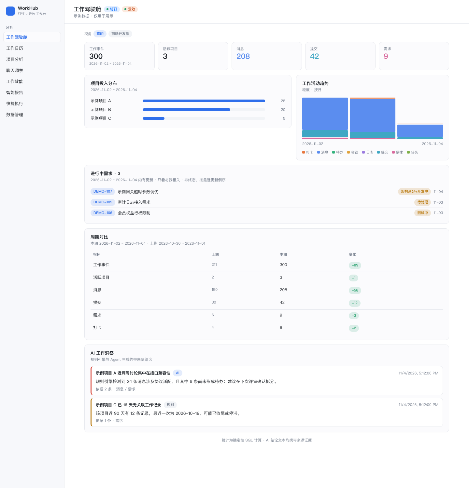
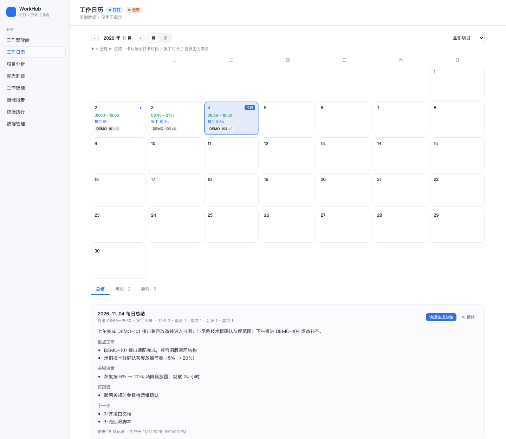
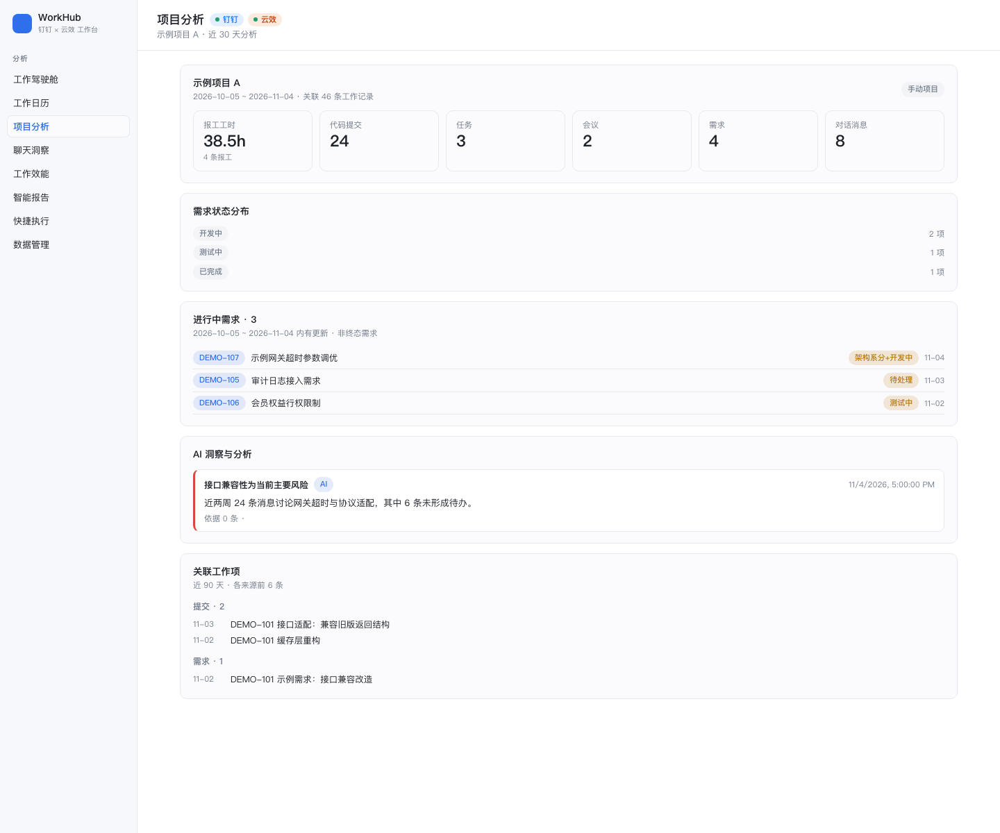
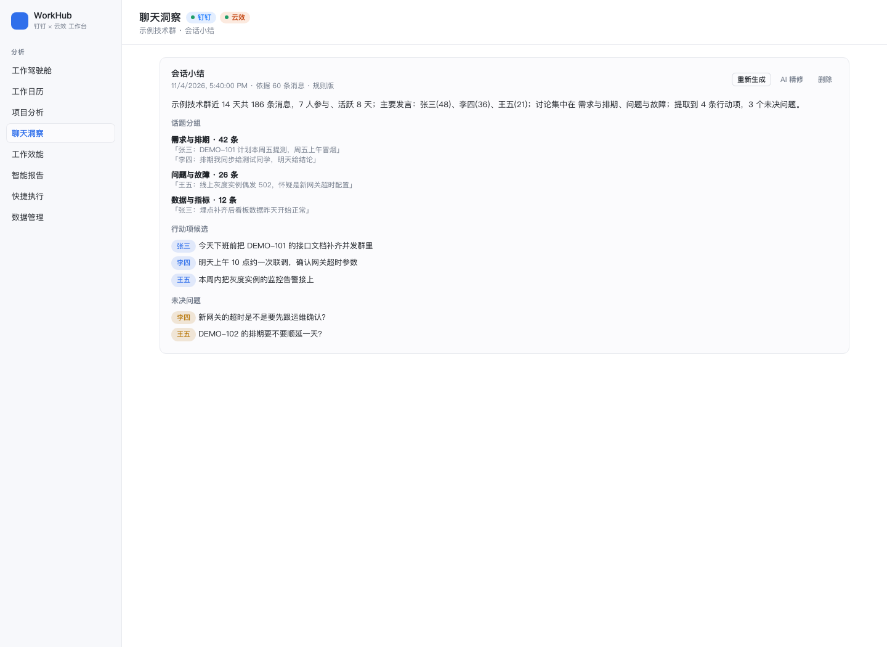
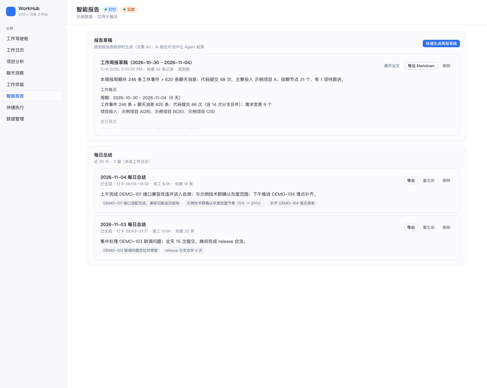
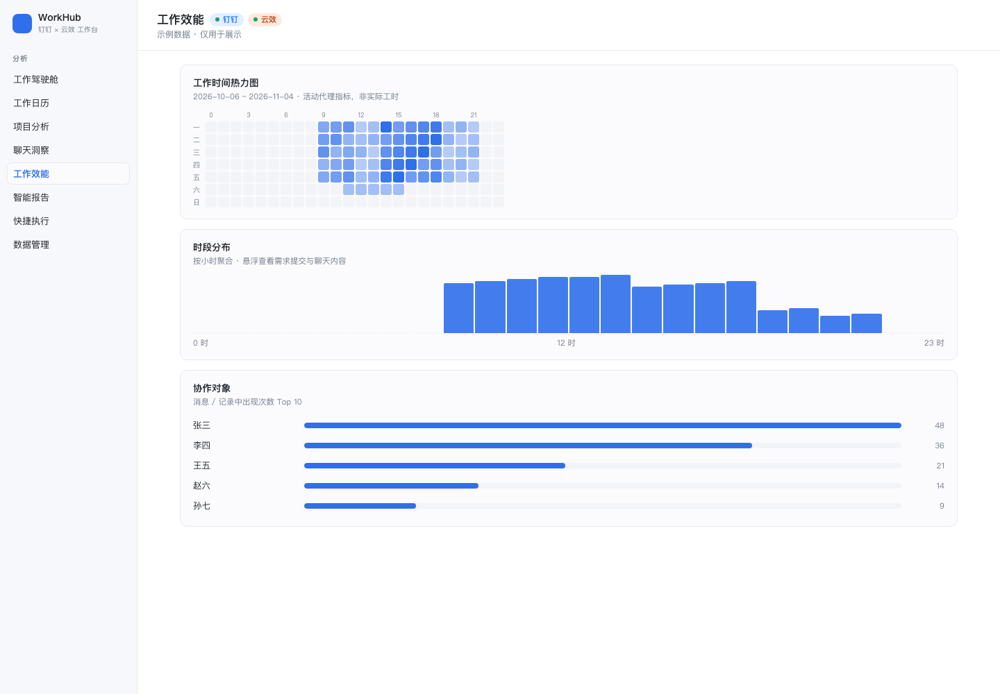
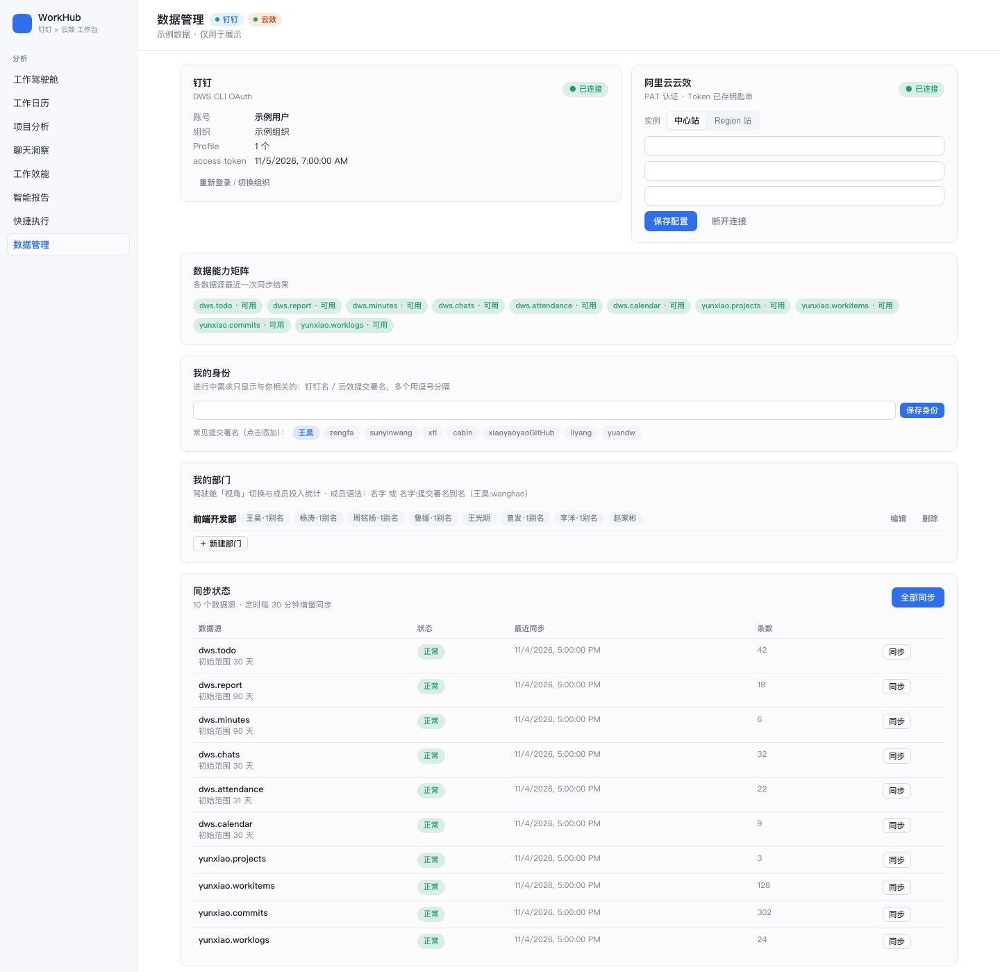
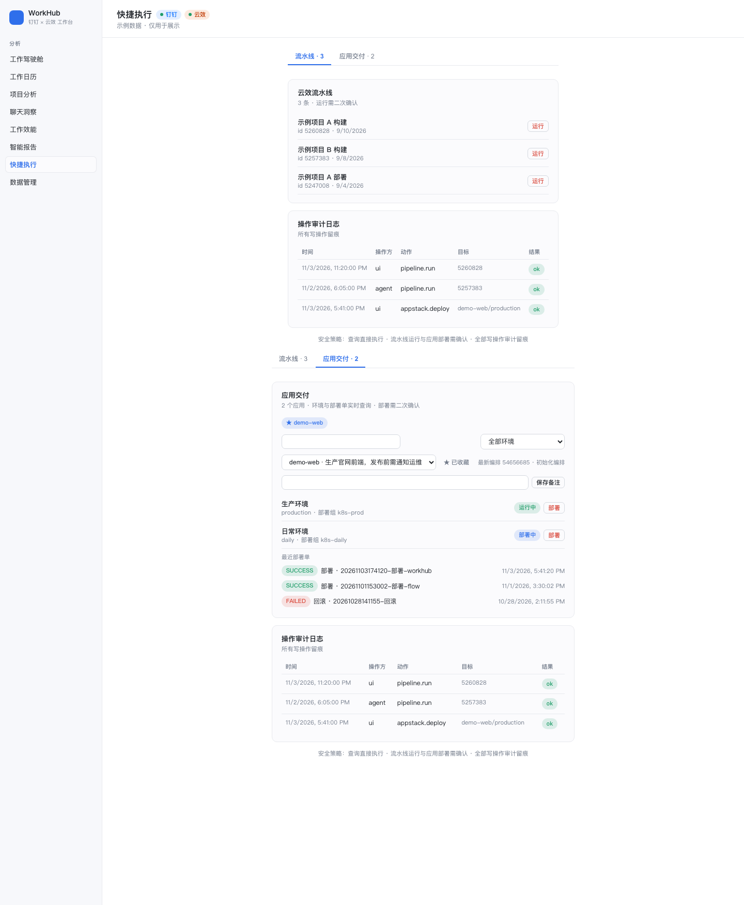

# WorkHub · 钉钉 × 云效 个人工作智能台

[](https://www.npmjs.com/package/@ahao430/dsh-workhub)
[](LICENSE)
[](https://github.com/ahao430/dsh-workhub/actions/workflows/ci.yml)

把钉钉与云效的工作数据聚合到本地，用确定性统计看清工作全貌，用 AI 总结回溯每件事的来源。

> 钉钉和云效记录工作，WorkHub 帮你看清工作如何发生、如何推进，以及下一步该做什么。

这是一个 **DeepSeek Harness（DSH）双端插件**：Host 侧负责数据采集、存储、分析与 Agent 工具；Client 侧以 React 面板形式嵌入 DSH Web UI。数据全部保存在本机 SQLite，不需要部署任何后端服务。

## 特性

**双数据源（11 个同步源）**

| 数据源 | 能力 |
| --- | --- |
| 钉钉（DWS CLI） | 待办、日志/日报、AI 听记（**含摘要 / 关键词 / 行动项**）、会话注册表、聊天消息（按需）、考勤打卡、**日历日程** |
| 云效（OpenAPI） | 项目空间、代码仓库、流水线、需求/任务、Commit、报工工时、**需求排期节点** |

**核心能力**

- **工作驾驶舱**：时间范围（含「上周五 → 本周四」报工周期）、粒度自动分级、上期对比、项目投入分布、活动趋势（tooltip 展示当日提交的需求号）、进行中需求（按「我的身份」过滤：更新人/创建人/负责人/参与人/提交署名）、AI 洞察卡
- **工作日历**：月/周视图，卡片优先展示打卡时段与报工时长、当日提交最多的需求号，**带钉钉日程数标记**；点选日期查看每日总结、云效排期节点、**当日钉钉日程·会议与到期待办（可一键完成）**、聚合后的事件时间线（原始明细可展开）
- **钉钉事务整合**：不复制钉钉界面——待办/日程/审批拆进日历、驾驶舱与报告：驾驶舱「今日待处理」（日程 + 到期待办 + 待我审批，可操作）；周报自动汇总待办新增与会议场次
- **项目分析**：手动项目（关键词/群绑定）与云效项目空间自动归集，展示报工工时、提交数、需求状态分布、跨系统关联工作项
- **聊天洞察**：会话选择与按需采集、发言统计、会话小结（话题分组 / 行动项 / 未决问题）、AI 话题聚类
- **工作效能**：周×小时热力图、时段分布、协作对象 Top 榜单
- **智能报告**：规则版周报/日报即时生成（工作概况 / 逐日概览 / 代码推进 / 排期节点 / 沟通协作 / 产出 / 风险 / 下周计划），支持导出 Markdown 与删除；**周五 17 点自动生成按人分区周报草稿**（可关闭）
- **快捷执行**：云效流水线运行、应用交付（Appstack 应用搜索/常用收藏/备注、环境状态与占用锁定、部署单历史 + 一键部署与按历史版本回滚），写操作二次确认 + 操作审计日志
- **研发流程（多环境部署）**：展示应用研发流程阶段（开发/测试/预发/生产），每阶段可运行——指定分支、修运行变量（release/app 等）、运行备注；运行进度实时轮询，终态推钉钉群通知（部署/回滚同样通知）
- **团队视角**：「我的身份」（钉钉名 + 提交署名别名）与部门分组（从钉钉组织架构逐级选择，未归属署名点选标记）；驾驶舱一键切换「我的 / 部门」，部门成员投入（提交 / 进行中需求 / 对话）按人聚合
- **自动识别**：新装零配置——自动识别钉钉账号与所在部门，一键采用；别名、收藏、备注、通知偏好均存本地
- **效率细节**：⌘K 命令面板（搜页面/应用）、下拉长列表自动搜索、toast 提示、表单跟随深浅色主题、插件更新检测（说「升级 workhub 插件」即可升级重载）
- **Agent 工具**：15 个 `workhub_*` 工具，全部只读或带确认；报告输入含按人维度（byPerson），AI 周报/日报可按人分区；AI 洞察与总结强制携带来源证据

## 界面预览

> 以下截图由 `tests/screenshot.mjs` 用**合成示例数据**渲染真实组件生成，不含任何真实组织或业务信息。



**工作日历**：卡片优先展示打卡时段、报工时长与当日主力需求；今日高亮。点选日期查看每日总结、云效排期节点、会议纪要与事件时间线。



**项目分析**：手动项目与云效项目空间统一归集，展示报工工时、提交数、需求状态分布与跨系统关联项。



**聊天洞察**：选定会话后直接生成会话小结——话题分组、行动项候选、未决问题，可导出或删除。



**智能报告**：规则版周报即时生成（工作概况 / 逐日概览 / 代码推进 / 会议与决策 / 沟通协作 / 风险 / 下周计划），支持导出 Markdown。



**工作效能**：周×小时热力图、时段分布与协作对象排行（活动代理指标，不等同于工时或生产力）。



**数据管理**：钉钉 / 云效双数据源连接状态、能力矩阵、12 个同步源与同步操作；云效 PAT 只存系统钥匙串。



**快捷执行**：云效流水线运行（二次确认）与应用交付（应用搜索/收藏/备注，一键部署与按历史部署单回滚），全部写操作审计留痕。



## 安装

包名：`@ahao430/dsh-workhub`（工作区目录形式的 bundle，`dsh.bundle` 指向 `cordis.patch.yml`）。

**从 npm 安装（推荐）：**

```bash
dsh plugin add @ahao430/dsh-workhub        # 装进当前 profile
```

**从 GitHub 源码安装：**

在 DSH 中用 `plugin_manager` 的 `install_bundle` 指向本仓库目录（或 `dsh plugin add github:ahao430/dsh-workhub`），随后用 `set_plugin` 启用 `workhub` 行。


> 插件市场：条目位于 [awesome-dsh-plugin](https://github.com/awesome-dsh-plugin/awesome-dsh-plugin)（`tools` 分类）；仓库根目录的 `screenshots.json` 用于市场详情页展示截图。

## 安装

需要先安装并登录 DWS CLI（`dws auth login`）。

```bash
# 在工作区克隆本仓库后，把插件安装进当前 DSH profile
# 安装动作由 DSH 的 plugin_manager 完成（见下文「安装到 DSH」）
```

本仓库是 **工作区目录形式的 DSH bundle**（`package.json` 中 `dsh.bundle.patch` + `dsh.client`），安装方式：

1. 在 DSH 中调用 `plugin_manager` 的 `install_bundle`，`target` 指向本目录绝对路径；
2. 安装后插件行 id 为 `workhub`，用 `set_plugin` 启用；
3. 刷新 DSH Web 页面，左侧边栏出现 WorkHub 图标。

## 配置云效

1. 云效控制台 → 个人设置 → 个人访问令牌 → 创建 PAT（建议权限：用户信息、项目、需求/任务、代码管理、报工；工作流可选）；
2. 打开 WorkHub「数据管理」→ 阿里云云效卡片；
3. 填入 API Base URL（中心站 `https://openapi-rdc.aliyuncs.com`，或你的 Region 专属域名）、组织 ID（可留空自动获取）、PAT；
4. 保存后 Token 写入**系统钥匙串**（macOS Keychain），SQLite 只保存 `credentialRef`，代码与日志均不落明文。

若 PAT 在某处泄露，请在云效侧轮换：生成新 Token 后在卡片里覆盖保存即可。

## 凭证过期怎么办

DWS 的 access token 约 2 小时一换，由 refresh token（约 30 天）自动续期，通常无感。refresh token 过期或被撤销后：

- **WorkHub 面板**：数据管理 → 钉钉卡片会变成红色「登录已失效 · 需重新登录」，并提供 **一键重新登录** 按钮（DSH Host 与本机同机，`dws auth login` 会自动打开浏览器完成 OAuth Loopback 授权，完成后面板自动刷新）
- 浏览器无法弹出时，卡片上保留 `dws auth login` 命令与复制按钮，可在终端执行
- 驾驶舱会出现一条 high 级洞察「钉钉登录已失效」，定时同步在重登前自动暂停（避免刷失败日志）
- **历史数据全程可读**：驾驶舱、日历、报告读的是本地 SQLite，只是不再增量更新

## 数据与隐私

- 所有数据仅存本地：`$DSH_PROFILE_DIR/workhub/data.db`（无 `DSH_PROFILE_DIR` 时回退 `~/.dsh/workhub/data.db`），SQLite `node:sqlite`。
- 聊天原文按需采集、按保留策略清理；总结与分析结论均以 `sourceReferences` 记录来源。
- 不复制 DWS 内部 Token；云效 PAT 只存系统钥匙串。
- 仓库内 `tests/fixtures/` 为脱敏示例数据，不含任何真实组织信息。

## 目录结构

```
dsh-workhub/
├── index.js                  # Host 入口：webServer 路由 / Agent 工具 / 定时同步
├── client.js                 # Client 入口：面板、页面、设计系统
├── lib/
│   ├── dws-executor.js       # 唯一 spawn 出口（超时/并发/输出上限/JSON 容错）
│   ├── dws-client.js         # 钉钉命令封装（argv 白名单）
│   ├── collector/            # 钉钉 & 云效采集器、同步管理
│   ├── yunxiao/client.js     # 云效 OpenAPI 客户端（node:https + PAT）
│   ├── storage/db.js         # SQLite schema、迁移、聚合查询
│   ├── security/credential-store.js  # 钥匙串凭证存储
│   ├── time.js               # 时间预设/粒度/对比区间
│   ├── watchdog.js           # 规则引擎（逾期、沉寂项目等）
│   ├── api.js                # 同源 HTTP API（只读 + 受控写）
│   └── tools.js              # Agent 工具注册
├── locale/                   # 插件展示元数据
└── tests/render-check.mjs    # 客户端渲染冒烟测试
```

## 开发

```bash
node --check client.js                  # 语法检查
node tests/render-check.mjs             # 渲染冒烟测试（8 个页面 + 数据子组件）
node tests/manifest-check.mjs           # 发布物料检查（清单 / files / 本地化 / 截图）
node tests/screenshot.mjs               # 用合成数据生成 docs/screens/*.html（再用无头浏览器转 PNG）
```

设计约定：

- 客户端只用 DSH 主题 token（`--dsw-alias-*`）做背景/边框/正文，强调色使用插件自有高对比色板（保证浅色/深色主题都清晰）；
- 所有钉钉调用集中经过 `DwsExecutor`，参数由白名单生成，禁止拼接 shell 字符串；
- 统计指标一律由 SQL 聚合产生，LLM 只做解释，且结论必须带来源。

## 发布

日常提交由 `.github/workflows/ci.yml` 自动跑语法检查、渲染冒烟测试和物料检查。发版以 git tag 为发布标记：

```bash
# 1. 改 package.json 的 version（如 0.2.0），提交推送
git commit -am "chore: 0.2.0" && git push

# 2. 打 tag 并推送（git tag 即发布记录，不走 npm 分发）
git tag v0.2.0 && git push origin v0.2.0
```

如需发布到 npm，本地执行 `npm publish --access public`（或按 tag 版本号恢复 Publish 工作流并配置 `NPM_TOKEN`）。

## 路线图

- [x] 会议纪要内容（听记摘要 / 关键词 / 行动项）与钉钉日程
- [x] 会话小结、周报/日报规则版生成与导出
- [ ] 考勤与工时交叉分析视图
- [ ] 云效缺陷（Bug）类别与合并请求（MR）
- [ ] 钉钉审批、文档/知识库、语音备忘
- [x] 云效应用交付（应用搜索/收藏/备注/部署/回滚，需 PAT「应用交付」权限）
- [x] 面板内直连模型的 AI 总结（复用 DSH 的 llm 服务：模型目录/默认模型/流式调用，插件零配置；内嵌聊天面板待做）
- [ ] 团队视图与多用户部署

## License

MIT

<!-- update-banner-e2e -->
